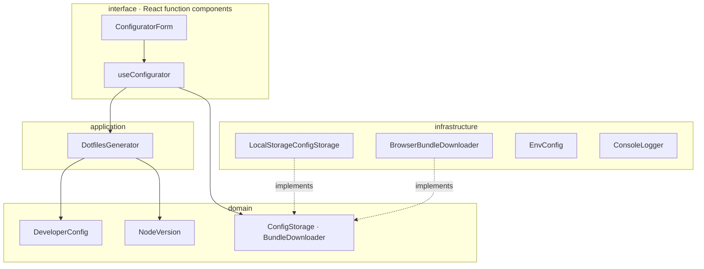

# Layers of the Dev environment configurator

**Architecture** · teaches Workstation setup

**Why this visual.** See the four layers of the app and that every dependency points inward, toward the domain.

## What it shows

React components and a hook sit in the interface layer, the generator in application, DeveloperConfig, NodeVersion and the ports in domain, and the storage, downloader, config and logger in infrastructure. Arrows point inward, so the domain knows nobody.

Text alternative: Four layers: interface holds ConfiguratorForm and useConfigurator, application holds DotfilesGenerator, domain holds DeveloperConfig, NodeVersion and the ports, infrastructure holds LocalStorageConfigStorage, BrowserBundleDownloader, EnvConfig and ConsoleLogger; every arrow points inward.

## Check yourself

Which layer holds DeveloperConfig, and which direction do the dependencies point?

Answer: The domain, and inward — the domain depends on nothing outside itself.

## Sources

- nvm-sh/nvm — https://github.com/nvm-sh/nvm (`nvm-sh-nvm-repo`)
- The Missing Semester of Your CS Education — https://missing.csail.mit.edu/ (`mit-missing-semester`)

## Used in

- `projects/frontend-engineering/learning-system-and-workstation/workstation-and-editor/capstone/ARCHITECTURE.md`
- [[06-capstone-workstation-and-editor]]

Back to [[visuals-workstation-and-editor|all visuals]].

## My insights
