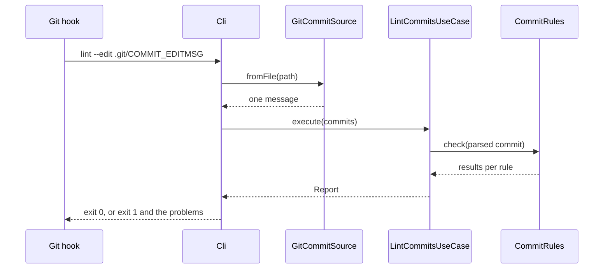

# Request flow of devkit lint --edit

**Sequence** · teaches [[Conventional Commits]], Git and GitHub fluency

**Why this visual.** Show what happens from the commit-msg hook to the exit code.

## What it shows

Git runs devkit with the message file. The Cli asks GitCommitSource for the message, LintCommitsUseCase parses it and asks CommitRules to check it, and the Report decides the exit code. Exit 0 lets the commit continue. Exit 1 stops it and prints each problem.

Text alternative: Sequence diagram: the Git hook calls Cli, which reads the message through GitCommitSource, passes it to LintCommitsUseCase and CommitRules, then returns a Report that becomes exit code 0 or 1 for Git.

## Check yourself

What stops the commit when a message is invalid?

Answer: The exit code 1 that Cli returns after Report.exitCode() sees an error-level result.

## Sources

- Conventional Commits 1.0.0 — https://www.conventionalcommits.org/en/v1.0.0/ (`conventionalcommits-spec-1-0-0`)
- conventional-changelog/commitlint — https://github.com/conventional-changelog/commitlint (`conventional-changelog-commitlint-repo`)

## Used in

- `projects/frontend-engineering/learning-system-and-workstation/workstation-and-editor/capstone/ARCHITECTURE.md`
- [[06-capstone-workstation-and-editor]]

Back to [[visuals-workstation-and-editor|all visuals]].

## My insights
