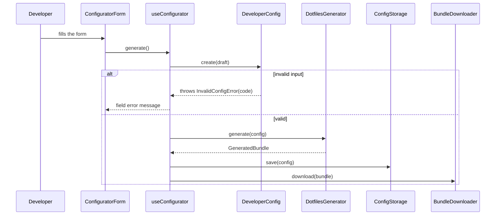

# Generate dotfiles request flow

**Sequence** · teaches Git and GitHub, Node version management

**Why this visual.** Follow one submit through validation, generation, save, and download, including the failure path.

## What it shows

The form calls generate, which validates the draft into a DeveloperConfig. Invalid input throws with a code and shows a field error; valid input generates a bundle, saves the config, and downloads the installer.

Text alternative: A sequence from Developer through ConfiguratorForm, useConfigurator, DeveloperConfig, DotfilesGenerator, ConfigStorage and BundleDownloader, branching where invalid input returns a coded error and valid input saves and downloads.

## Check yourself

Where does invalid input stop the flow?

Answer: In DeveloperConfig.create, which throws an InvalidConfigError with a code before anything is generated or saved.

## Sources

- nvm-sh/nvm — https://github.com/nvm-sh/nvm (`nvm-sh-nvm-repo`)
- Set up Git — https://docs.github.com/en/get-started/git-basics/set-up-git (`github-set-up-git-docs`)

## Used in

- `projects/frontend-engineering/learning-system-and-workstation/workstation-and-editor/capstone/ARCHITECTURE.md`

Back to [[visuals-workstation-and-editor|all visuals]].

## My insights
