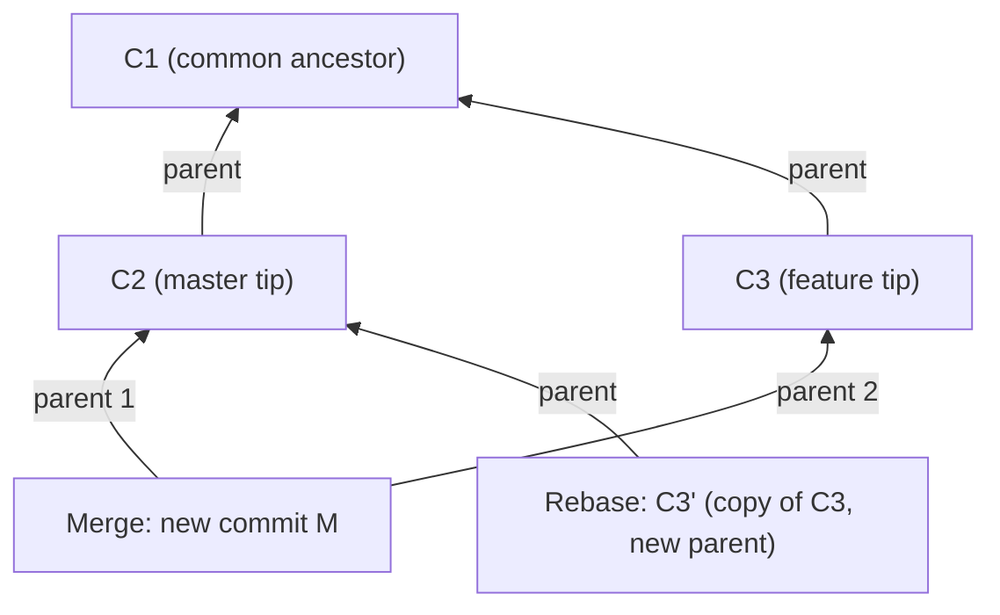

# Merge versus rebase in the commit graph

**Comparison** · teaches Merge versus rebase, Commit graph and branches, Resolving merge conflicts

**Why this visual.** Compare how merge and rebase join two diverged branches in the commit graph.

## What it shows

Pro Git 3.2 says a three-way merge combines the two branch tips and their common ancestor into a new snapshot and records a merge commit with more than one parent. Pro Git 3.6 says rebase finds the common ancestor, takes the diff of each commit, resets the branch to the target and applies each change in turn. The final snapshot is the same; the history differs. Arrows point from a commit to its parent.

Text alternative: Graph: C2 and C3 both point to C1. A merge commit M points to both C2 and C3. After rebase, C3 prime points to C2, giving a straight line.

## Check yourself

Both merge and rebase give the same final files. What is different in the history?

Answer: Merge adds a commit with two parents and keeps both lines of work. Rebase rewrites the branch commits as copies on top of the target, so history is a straight line.

## Sources

- Pro Git — https://git-scm.com/book/en/v2 (`chacon-2014-pro-git`)

## Used in

- [[chacon-2014-pro-git-workstation-and-editor]]

Back to [[visuals-workstation-and-editor|all visuals]].

## My insights
