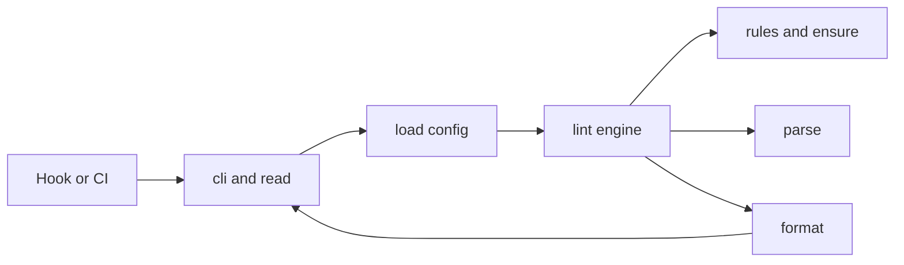

# commitlint module map

**Architecture** · teaches [[Conventional Commits]]

**Why this visual.** Show which commitlint package does which job, so you can plan the same split in a small CLI.

## What it shows

commitlint splits one check into small packages. The CLI reads the message and exits. The loader builds the config. The lint engine ignores, parses and runs rules. The rules judge one part each. The formatter prints the result. Evidence: cli.ts:298-325, lint.ts:24-178, format.ts:55-93 at commit d2be18a.

Text alternative: Flowchart: a hook or CI job calls the CLI and reader, which load config, then the lint engine; the engine calls the parser and the rules, and the formatter sends the report back to the CLI.

## Check yourself

Which package decides the exit code, and which one decides if a message is valid?

Answer: The CLI package picks the exit code from the report. The lint engine decides validity from rule results with level 2.

## Sources

- conventional-changelog/commitlint — https://github.com/conventional-changelog/commitlint (`conventional-changelog-commitlint-repo`)

## Used in

- [[commitlint-architecture]]

Back to [[visuals-workstation-and-editor|all visuals]].

## My insights
