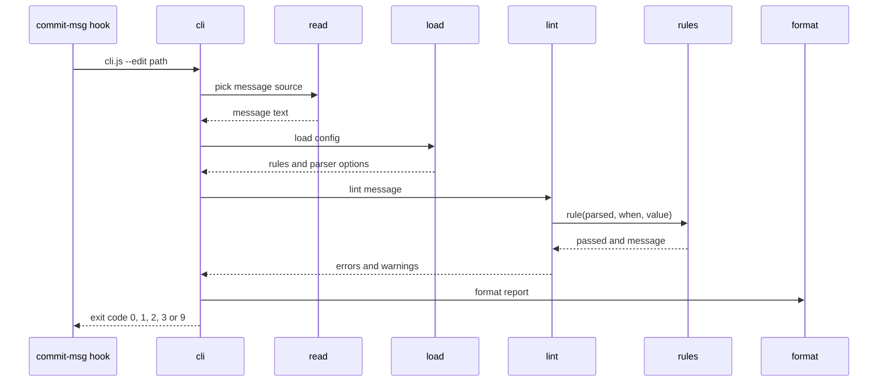

# commitlint request flow

**Sequence** · teaches [[Conventional Commits]]

**Why this visual.** Follow one commit message from the Git hook to an exit code.

## What it shows

Git runs the hook, which calls the CLI with the message file. The CLI reads the text, loads the config, lints, formats the report and exits with a number that the hook or CI reads. Evidence: .husky/commit-msg:1, cli.ts:298-405 at commit d2be18a.

Text alternative: Sequence diagram: the commit-msg hook calls the CLI, which reads the message, loads config, asks the lint engine to run each rule, formats the report, and returns exit code 0, 1, 2, 3 or 9 to the hook.

## Check yourself

What does the hook see when the message breaks an error-level rule?

Answer: A non-zero exit code, 1 by default, and the commit is stopped.

## Sources

- conventional-changelog/commitlint — https://github.com/conventional-changelog/commitlint (`conventional-changelog-commitlint-repo`)

## Used in

- [[commitlint-architecture]]

Back to [[visuals-workstation-and-editor|all visuals]].

## My insights
