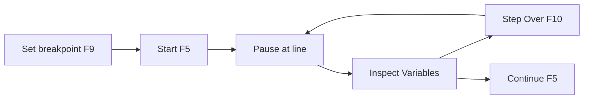

# One debug session in VS Code

**Workflow** · teaches Debugging JavaScript in the editor

**Why this visual.** Show the loop of a debug session: set a breakpoint, start, pause, inspect, step or continue.

## What it shows

VS Code docs, Debugging: press F9 to set a breakpoint and F5 to start. Execution pauses at the line; the Variables and Call Stack sections show the state. Step Over (F10) runs one line and pauses again; Continue (F5) runs to the next breakpoint or the end.

Text alternative: Flowchart: set breakpoint with F9, start with F5, pause at the line, inspect variables, then either step over with F10 and pause again, or continue with F5 to the next breakpoint.

## Check yourself

You paused at a breakpoint and want to see the next line change a value. Which key do you press?

Answer: F10, Step Over, which runs the current line and pauses again.

## Sources

- Visual Studio Code documentation — https://code.visualstudio.com/docs/getstarted/settings (`vscode-settings-docs`)

## Used in

- lesson page `/frontend-engineering/learning-system-and-workstation/workstation-and-editor/lesson/05-editor-setup-and-debugging/` (file `site/src/content/lessons/frontend-engineering/learning-system-and-workstation/workstation-and-editor/05-editor-setup-and-debugging.mdx`)

Back to [[visuals-workstation-and-editor|all visuals]].

## My insights
