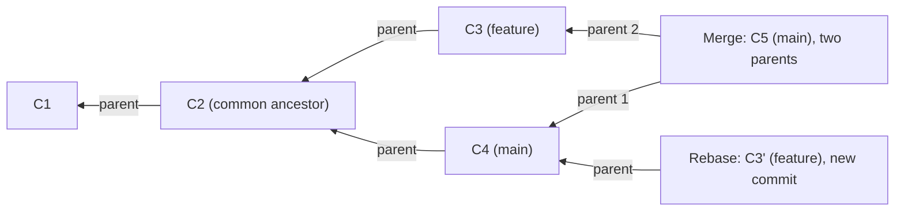

# One fork, joined by merge or by rebase

**Comparison** · teaches Commit graph and branches, Merge versus rebase

**Why this visual.** Show both results of joining the same fork, so the learner can compare the two graphs without the animation.

## What it shows

C3 on feature and C4 on main both have the parent C2. Merge, run on main, records C5 with the two parents C4 and C3 (Pro Git 3.2). Rebase, run on feature, applies the change of C3 as a new commit C3' with the parent C4, so the history is a straight line (Pro Git 3.6). Arrows point from a commit to its parent.

Text alternative: Commit graph: C3 and C4 point to C2, which points to C1. A merge commit C5 points to both C4 and C3. A rebased commit C3' points only to C4.

## Check yourself

Which result has a commit with two parents, and which one creates a copy of an existing commit?

Answer: Merge creates C5 with two parents. Rebase creates C3', a new commit that copies the change of C3.

## Sources

- Pro Git — https://git-scm.com/book/en/v2 (`chacon-2014-pro-git`)

## Used in

- `projects/frontend-engineering/learning-system-and-workstation/workstation-and-editor/experiences/git-graph-lab/experience.json`
- lesson page `/frontend-engineering/learning-system-and-workstation/workstation-and-editor/lesson/02-git-commit-graph/` (file `site/src/content/lessons/frontend-engineering/learning-system-and-workstation/workstation-and-editor/02-git-commit-graph.mdx`)

Back to [[visuals-workstation-and-editor|all visuals]].

## My insights
