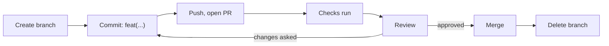

# GitHub flow for one pull request

**Workflow** · teaches Pull request workflow (GitHub flow), [[Conventional Commits]]

**Why this visual.** Show the ordered steps of GitHub flow and where review and checks can send a change back.

## What it shows

GitHub flow (GitHub Docs): create a branch, commit changes, push and open a pull request, address review, merge, then delete the branch. Checks configured on the repository run on the pull request; commitlint runs in CI on the pull request range (.github/workflows/commitlint.yml:46-52 @ d2be18a). New commits update the open pull request.

Text alternative: Flowchart: create branch, commit with a feat message, push and open a pull request, checks run, review; changes asked loops back to commit, approved leads to merge and then delete branch.

## Check yourself

A reviewer asks for a change. Do you open a new pull request?

Answer: No. You commit and push on the same branch, and the open pull request updates automatically.

## Sources

- GitHub flow — https://docs.github.com/en/get-started/using-github/github-flow (`github-flow-docs`)
- conventional-changelog/commitlint — https://github.com/conventional-changelog/commitlint (`conventional-changelog-commitlint-repo`)

## Used in

- lesson page `/frontend-engineering/learning-system-and-workstation/workstation-and-editor/lesson/04-pull-requests-and-conventional-commits/` (file `site/src/content/lessons/frontend-engineering/learning-system-and-workstation/workstation-and-editor/04-pull-requests-and-conventional-commits.mdx`)

Back to [[visuals-workstation-and-editor|all visuals]].

## My insights
