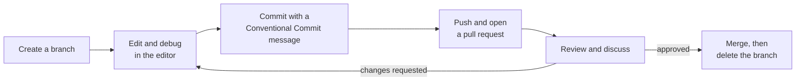

# One change from branch to merge

**Workflow** · teaches Git and GitHub fluency, Pull request workflow (GitHub flow), [[Conventional Commits]], Editor setup: VS Code, JetBrains or Zed

**Why this visual.** Show where each workstation tool fits in one change: from a new branch to a merged pull request.

## What it shows

GitHub flow (GitHub Docs) is: create a branch, make and commit changes, push, open a pull request, address review comments, merge, then delete the branch. The editor step uses the VS Code debugger (VS Code docs, Debugging). The commit message follows the Conventional Commits 1.0.0 format, so tools can build release notes from history. Review can send the change back to the editor before it is merged.

Text alternative: Flowchart: create a branch, edit and debug in the editor, commit with a Conventional Commit message, push and open a pull request, review; changes requested loops back to edit, approved leads to merge and delete the branch.

## Check yourself

A reviewer asks for a change on your open pull request. Where do you go next, and do you open a new pull request?

Answer: Back to the editor on the same branch. You commit and push again; the open pull request updates, so you do not open a new one.

## Sources

- GitHub flow — https://docs.github.com/en/get-started/using-github/github-flow (`github-flow-docs`)
- Conventional Commits 1.0.0 — https://www.conventionalcommits.org/en/v1.0.0/ (`conventionalcommits-spec-1-0-0`)
- Visual Studio Code documentation — https://code.visualstudio.com/docs/getstarted/settings (`vscode-settings-docs`)

## Used in

- [[01-brief-workstation-and-editor]]

Back to [[visuals-workstation-and-editor|all visuals]].

## My insights
