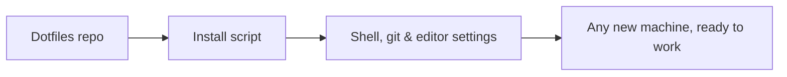

# The reproducible workstation

**Workflow** · teaches Workstation setup

**Why this visual.** See the reproducible workstation as one install flow.

## What it shows

Your configuration lives in a versioned dotfiles repository. An install script links those files into place, producing a shell, git, and editor setup that any new machine can reproduce in minutes.

Text alternative: Four steps left to right: a dotfiles repo feeds an install script, which creates shell, git and editor settings, which make any new machine ready to work.

## Check yourself

Which file makes the setup reproducible on a new machine?

Answer: The dotfiles repository, because it holds the configuration and the install script that links it into place.

## Sources

- The Missing Semester of Your CS Education — https://missing.csail.mit.edu/ (`mit-missing-semester`)

## Used in

- [[01-brief-workstation-and-editor]]

Back to [[visuals-workstation-and-editor|all visuals]].

## My insights
