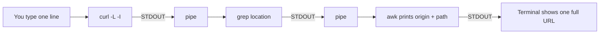

# How a pipe connects one command to the next

**Flowchart** · teaches Terminal and shell

**Why this visual.** Show how one command line hands its output to the next command through a pipe, so the learner can read and build a chain.

## What it shows

You type one command line. Each program writes text to standard output (STDOUT). The pipe symbol takes that text out of the screen and feeds it into the next program as standard input (STDIN). The last program writes its result to the terminal. The example is the article's own chain: curl fetches the response headers with -L to follow redirects and -I for headers only, grep keeps the lines that contain 'location', and awk prints the origin in front of the path in the second field.

Text alternative: Flow diagram: you type one line, curl -L -I writes headers to STDOUT, a pipe feeds grep location, grep writes matching lines to STDOUT, a second pipe feeds awk, awk prints the origin plus the path, and the terminal shows one full URL.

## Check yourself

In `ls | wc -l`, which program reads from standard input, and what does the terminal show?

Answer: wc reads the text that ls wrote to STDOUT, counts its lines, and prints only that count to the terminal. You never see the file list.

## Sources

- Command line crash course (MDN Learn web development, Environment setup) — https://developer.mozilla.org/en-US/docs/Learn_web_development/Getting_started/Environment_setup/Command_line (`mdn-command-line`)

## Used in

- [[mdn-command-line-workstation-and-editor]]

Back to [[visuals-workstation-and-editor|all visuals]].

## My insights
