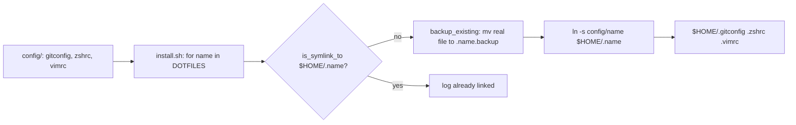

# Dotfiles install: repo to $HOME via symlinks

**Workflow** · teaches Workstation setup

**Why this visual.** See how one install script turns a dotfiles repo into a live home-directory setup.

## What it shows

install.sh loops over each config file, skips a link that already points at it, backs up any real file, then symlinks the repo file into $HOME.

Text alternative: Config files gitconfig, zshrc and vimrc flow into install.sh, which checks for an existing link, backs up a real file, and creates a symlink into the home directory.

## Check yourself

Why does install.sh back up a real .zshrc before linking?

Answer: To keep the machine's old settings instead of overwriting them when the symlink replaces the file.

## Sources

- The Missing Semester of Your CS Education — https://missing.csail.mit.edu/ (`mit-missing-semester`)

## Used in

- `projects/frontend-engineering/learning-system-and-workstation/workstation-and-editor/mini-01-dotfiles/README.md`

Back to [[visuals-workstation-and-editor|all visuals]].

## My insights
