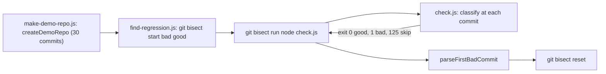

# Bisect run flow

**Workflow** · teaches Finding a bad commit with git bisect, Commit graph and branches, Terminal and shell basics

**Why this visual.** Show how the script and git bisect run cooperate to find the first bad commit.

## What it shows

The script find-regression.js starts git bisect with a bad and a good commit. Git checks out commits by binary search and runs check.js. The exit code (0 good, 1 bad, 125 skip) steers the search. At the end the first bad commit is parsed and the repo is reset (git-scm docs, git-bisect).

Text alternative: Flowchart: create demo repo, git bisect start, git bisect run node check.js, check.js returns an exit code back to bisect run, parse first bad commit, git bisect reset.

## Check yourself

What does check.js return for a commit whose price.js has a syntax error?

Answer: 125, so Git skips that commit instead of calling it bad.

## Sources

- Git reference manual: git-bisect and git-reflog — https://git-scm.com/docs/git-bisect (`git-scm-docs`)
- Pro Git — https://git-scm.com/book/en/v2 (`chacon-2014-pro-git`)

## Used in

- `projects/frontend-engineering/learning-system-and-workstation/workstation-and-editor/mini-01-bisect-the-regression/README.md`

Back to [[visuals-workstation-and-editor|all visuals]].

## My insights
