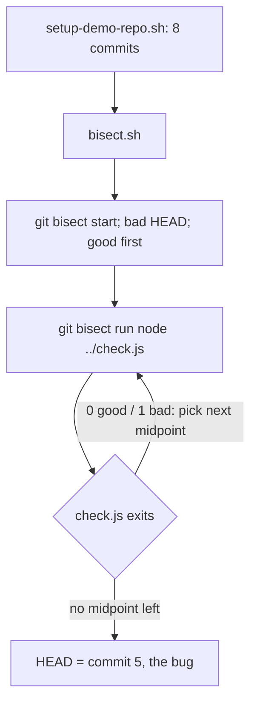

# git bisect narrows to the bug commit

**Workflow** · teaches Git and GitHub

**Why this visual.** See how git bisect halves the commit range using one test until only the bug commit remains.

## What it shows

bisect.sh marks HEAD bad and the first commit good, then git bisect run invokes check.js at each midpoint. check.js exits 0 for good and 1 for bad, so git halves the range each step and stops at commit 5.

Text alternative: A flow from setup-demo-repo.sh to bisect.sh, which marks the range, then loops through git bisect run and check.js exit codes until HEAD ends on commit 5.

## Check yourself

What does check.js exit 1 tell git bisect?

Answer: That the current commit is bad, so git searches the older half of the remaining range.

## Sources

- Pro Git — https://git-scm.com/book/en/v2 (`pro-git-book`)

## Used in

- `projects/frontend-engineering/learning-system-and-workstation/workstation-and-editor/mini-02-git-bisect-hunt/README.md`

Back to [[visuals-workstation-and-editor|all visuals]].

## My insights
