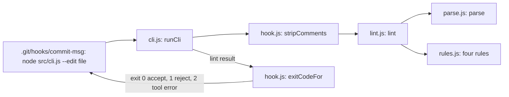

# Commit-msg hook lint flow

**Workflow** · teaches [[Conventional Commits]]

**Why this visual.** Show how a commit-msg hook turns a commit message into an exit code.

## What it shows

Git runs the commit-msg hook with the message file. cli.js reads it, hook.js removes comment lines, lint.js parses the message and runs the rules, and exitCodeFor returns 0 or 1. Git blocks the commit on a non-zero code (Conventional Commits 1.0.0; git-scm githooks).

Text alternative: Flowchart: commit-msg hook calls cli.js runCli, which calls stripComments, then lint with parse and rules, then exitCodeFor, whose exit code returns to the hook.

## Check yourself

Which exit code makes Git stop the commit, and which function chooses it?

Answer: Any non-zero code; exitCodeFor returns 1 when the message has an error.

## Sources

- Conventional Commits 1.0.0 — https://www.conventionalcommits.org/en/v1.0.0/ (`conventionalcommits-spec-1-0-0`)
- conventional-changelog/commitlint — https://github.com/conventional-changelog/commitlint (`conventional-changelog-commitlint-repo`)
- Git reference manual: git-bisect and git-reflog — https://git-scm.com/docs/git-bisect (`git-scm-docs`)

## Used in

- `projects/frontend-engineering/learning-system-and-workstation/workstation-and-editor/mini-02-commit-message-linter/README.md`

Back to [[visuals-workstation-and-editor|all visuals]].

## My insights
