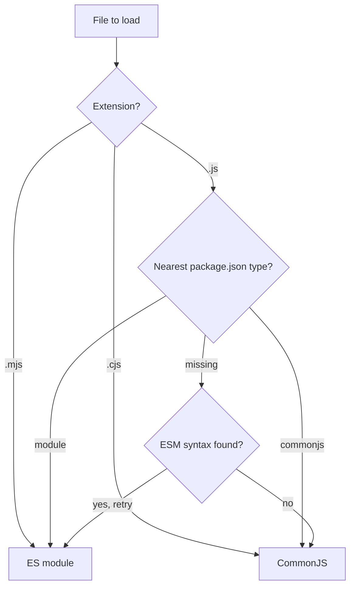

# Which loader Node.js uses for a file

**Decision tree** · teaches ESM versus CommonJS loading

**Why this visual.** Show how Node.js picks ES module or CommonJS loading for one file, so the learner can predict it.

## What it shows

Node.js reads the file extension first. A .mjs file is always an ES module and a .cjs file is always CommonJS. For .js it looks at the type field of the nearest package.json. If there is no type field, it runs the file as CommonJS and retries as an ES module when it finds import or export syntax.

Text alternative: Decision diagram: .mjs leads to ES module, .cjs leads to CommonJS, .js depends on the nearest package.json type; module is ESM, commonjs is CommonJS, missing type tries CommonJS and retries as ESM when ES module syntax is found.

## Check yourself

A .js file has no type field in any package.json and contains an import statement. How does Node.js load it?

Answer: It treats the file as ambiguous, detects the ES module syntax, and loads it as an ES module (syntax detection, with a performance cost). Setting type avoids the guess.

## Sources

- Node.js documentation: Packages (module system, type field) and Corepack (packageManager) — https://nodejs.org/api/packages.html (`nodejs-packages-docs`)

## Used in

- [[nodejs-packages-docs-workstation-and-editor]]
- lesson page `/frontend-engineering/learning-system-and-workstation/workstation-and-editor/lesson/07-node-versions-and-modules/` (file `site/src/content/lessons/frontend-engineering/learning-system-and-workstation/workstation-and-editor/07-node-versions-and-modules.mdx`)

Back to [[visuals-workstation-and-editor|all visuals]].

## My insights
