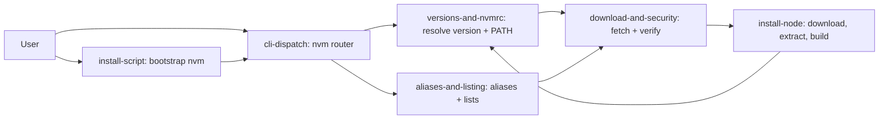

# nvm's modules and how they call each other

**Architecture** · teaches Node version management

**Why this visual.** See how one shell script is split into responsibilities that call each other.

## What it shows

The installer bootstraps nvm, the router dispatches each command, resolution turns a request into a version, and download plus install fetch and verify it. Each arrow matches a function call cited in the architecture note.

Text alternative: A flowchart: the user reaches either install-script or the cli-dispatch router, the router calls version resolution and alias listing, and both lead into download-and-security and then install-node.

## Check yourself

Which module writes the new node onto the PATH?

Answer: versions-and-nvmrc, via nvm_change_path, after install-node has installed the binary.

## Sources

- nvm-sh/nvm — https://github.com/nvm-sh/nvm (`nvm-sh-nvm-repo`)

## Used in

- [[nvm-architecture]]

Back to [[visuals-workstation-and-editor|all visuals]].

## My insights
