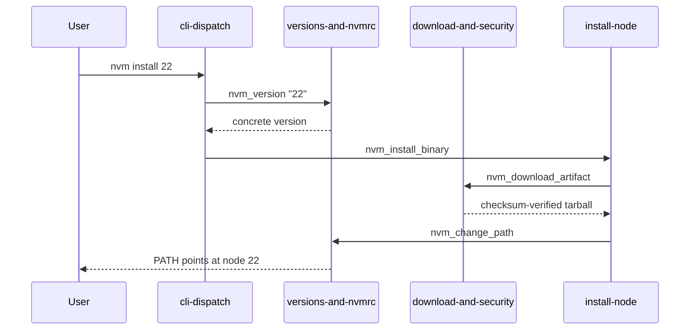

# One nvm install request end to end

**Sequence** · teaches Node version management

**Why this visual.** Follow one `nvm install 22` through resolution, download, verification, and the PATH rewrite.

## What it shows

The command resolves the shorthand to a version, fetches the version index, downloads the tarball, verifies its checksum, then rewrites PATH. Each message is a function call cited in the architecture note.

Text alternative: A sequence diagram where the user calls nvm install, the router resolves the alias, download-and-security returns a verified tarball, install-node installs it, and versions-and-nvmrc rewrites PATH.

## Check yourself

Which step must pass before the tarball is moved into the cache?

Answer: The checksum comparison, so an unverified archive is never cached.

## Sources

- nvm-sh/nvm — https://github.com/nvm-sh/nvm (`nvm-sh-nvm-repo`)

## Used in

- [[nvm-architecture]]

Back to [[visuals-workstation-and-editor|all visuals]].

## My insights
