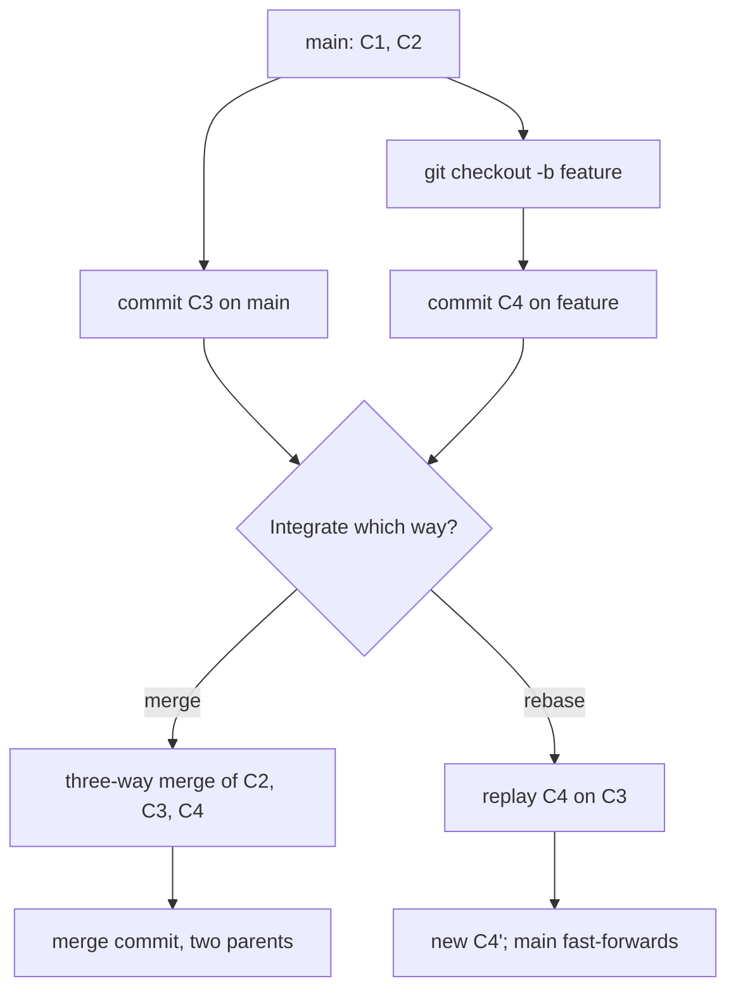

# Merge or rebase: two ways to integrate a branch

**Decision tree** · teaches Git and GitHub

**Why this visual.** Tell apart the two ways Git integrates one branch into another, and predict what each does to the history.

## What it shows

Two branches diverge from a common ancestor C2: main adds C3, the feature branch adds C4. A merge combines the two tips with C2 in a three-way merge and records the result in a commit with two parents. A rebase replays C4's change on top of C3 as a new commit, so main can then fast-forward to it. Both end with the same files; only the history differs (Pro Git, Git Branching, sections Basic Branching and Merging and Rebasing).

Text alternative: Flow from a shared commit C2: main gains C3, a feature branch gains C4, then a choice. Merge runs a three-way merge of C2, C3 and C4 and creates a commit with two parents. Rebase replays C4 on C3, creating a new commit that main fast-forwards to.

## Check yourself

Both paths end with the same file contents. What is actually different?

Answer: Only the history: merge keeps both lines and adds a commit with two parents, while rebase writes new commits in a straight line and abandons the originals.

## Sources

- Pro Git — https://git-scm.com/book/en/v2 (`pro-git-book`)

## Used in

- [[pro-git-book-workstation-and-editor]]

Back to [[visuals-workstation-and-editor|all visuals]].

## My insights
