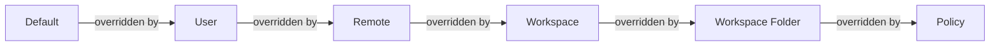

# VS Code settings precedence

**Layered** · teaches Settings layers and workspace settings, Editor setup: VS Code, JetBrains or Zed

**Why this visual.** Show which settings scope wins when two scopes set the same setting.

## What it shows

VS Code docs, Settings precedence: later scopes override earlier ones. The order is Default, User, Remote, Workspace, Workspace Folder. Policy settings from an administrator always win. Language-specific settings sit between Workspace Folder and Policy and are left out here.

Text alternative: Chain of six settings scopes from left to right: Default, User, Remote, Workspace, Workspace Folder, Policy; each scope is overridden by the next, so Policy wins and a workspace value beats a user value.

## Check yourself

Your user settings say tabSize 4 and the project's .vscode/settings.json says 2. Which value applies?

Answer: 2, because Workspace overrides User.

## Sources

- Visual Studio Code documentation — https://code.visualstudio.com/docs/getstarted/settings (`vscode-settings-docs`)

## Used in

- lesson page `/frontend-engineering/learning-system-and-workstation/workstation-and-editor/lesson/05-editor-setup-and-debugging/` (file `site/src/content/lessons/frontend-engineering/learning-system-and-workstation/workstation-and-editor/05-editor-setup-and-debugging.mdx`)

Back to [[visuals-workstation-and-editor|all visuals]].

## My insights
