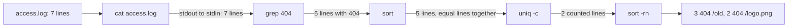

# Text through the stages of a shell pipeline

**Workflow** · teaches Pipes and redirection

**Why this visual.** See how each command in a pipeline reads the output of the command before it.

## What it shows

Each pipe connects one command's standard output to the next command's standard input, so the line count changes from 7 to 5 to 2.

Text alternative: access.log goes into cat, which sends 7 lines to grep 404; grep sends 5 lines to sort; sort sends 5 grouped lines to uniq -c; uniq -c sends 2 counted lines to sort -rn, which prints 3 404 /old and 2 404 /logo.png.

## Check yourself

What does sort read in this pipeline?

Answer: The five lines that grep 404 wrote, not the file.

## Sources

- Bash Reference Manual — https://www.gnu.org/software/bash/manual/bash.html (`gnu-bash-manual`)

## Used in

- `projects/frontend-engineering/learning-system-and-workstation/workstation-and-editor/experiences/shell-pipeline-lab/experience.json`
- lesson page `/frontend-engineering/learning-system-and-workstation/workstation-and-editor/lesson/01-terminal-and-shell/` (file `site/src/content/lessons/frontend-engineering/learning-system-and-workstation/workstation-and-editor/01-terminal-and-shell.mdx`)

Back to [[visuals-workstation-and-editor|all visuals]].

## My insights
