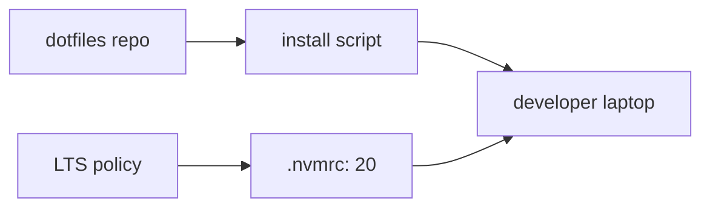

# A production team's reproducible setup

**Workflow** · teaches Workstation setup, Node version management

**Why this visual.** See how a team turns shared configuration into identical developer machines.

## What it shows

One dotfiles repo holds the shell, git, and editor config. An install script links those files onto each new laptop, and a `.nvmrc` that pins an LTS version keeps every machine on the same Node runtime.

Text alternative: A dotfiles repo feeds an install script, which reproduces a developer laptop. A Long-Term Support policy sets the version a `.nvmrc` file pins, and that file pins the same Node version on every laptop.

## Check yourself

A new hire's Node differs from the team's. Which file makes it match?

Answer: The shared `.nvmrc`, which pins the LTS version the policy chose.

## Sources

- The Missing Semester of Your CS Education — https://missing.csail.mit.edu/ (`mit-missing-semester`)
- nvm-sh/nvm — https://github.com/nvm-sh/nvm (`nvm-sh-nvm-repo`)
- Node.js Releases (release statuses, LTS schedule and installation methods) — https://nodejs.org/en/about/previous-releases (`nodejs-releases-docs`)

## Used in

- lesson page `/frontend-engineering/learning-system-and-workstation/workstation-and-editor/lesson/07-a-production-teams-setup/` (file `site/src/content/lessons/frontend-engineering/learning-system-and-workstation/workstation-and-editor/07-a-production-teams-setup.mdx`)

Back to [[visuals-workstation-and-editor|all visuals]].

## My insights
